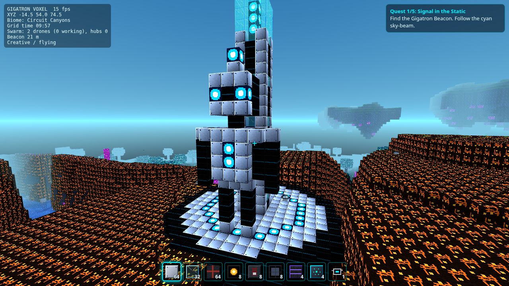

# GIGATRON: Swarm Frontier

A free, original voxel sandbox that runs in your browser. Explore a procedurally generated cyber
frontier, build energy circuits, befriend a swarm of drones, and find **Gigatron**, the chrome-and-black
guardian robot with a cyan core.

**Play:** https://1ntern0t.github.io/gigatron-voxel/



> Inspired by the voxel sandbox genre; not affiliated with any other game. All textures, models and
> sounds are generated procedurally in code. No third-party game assets are used.

Free forever: no ads, no purchases, no accounts, no wallets, no tracking.

## Features

### Working (tested by unit tests and/or a headless-browser run)

- **Infinite chunked terrain** (16×16×96 chunks) generated from a shareable seed, with four biomes:
  Neon Crystal Plains, Data-Stream Rivers, Circuit Canyons and Floating Sky Islands. Ores, crystal
  spires and data-trees are included.
- **Building:** break and place blocks, use a 9-slot hotbar, a 36-slot inventory, and middle-click to pick a block.
  There is a survival-lite mode where breaking a block gives you that block, and a creative mode with infinite blocks and flight.
- **Lighting:** sky light and block light flood-fill, smooth per-vertex lighting with ambient occlusion,
  and emissive blocks (crystals, lamps, cores, live wires) that light up the area around them.
- **Day/night cycle** (10 minutes) with an aurora, stars, sun/moon, data streaks and distance fog.
- **Meshing in Web Workers:** a culled-face mesher with a padded volume makes chunk borders seamless.
  World generation and meshing run in a worker pool. Your own edits are re-meshed on the main thread straight away.
  The default render distance is 8 chunks.
- **Energy grid** (simulated at 5 Hz):
  - Power Node (always on) and Switch
  - Power Wire, which conducts in all 6 directions
  - Lumen Lamp and Energy Door
  - Inverter Gate, for NOT logic and clocks
- **Swarm drones:**
  - Deploy a Drone Pod, or bond with a wild drone (press E; costs 1 Neon Crystal).
  - Followers fly in formation and fetch dropped items for you.
  - Assign a drone to a **Swarm Hub** (press Q next to it) and it mines crystal within 8 blocks.
  - Hubs within 24 blocks of an older hub link into **chains** and forward cargo down the line.
- **Gigatron Beacon:** a spire with a sky-beam and a voxel Gigatron statue, 36–64 blocks from spawn.
  Gigatron gives lore and a line of **5 quests** (find the beacon, build a swarm, light a lamp,
  harvest crystal, build a hub chain), each with rewards.
- **Saving:** autosave every 30 s and when you leave the page, to IndexedDB (falling back to localStorage).
  You can have multiple worlds, copy a seed share link (`?seed=...`) and export a world file.
- **Desktop and mobile controls**, plus an in-game help screen and an in-game Support page.
- **Synthesized sound effects** using WebAudio (no audio files).

### Multiplayer

- **Public Lobby** (one shared, persistent survival world) with an honest live player count, three
  server bots (WARDEN, SPARK, HIVE), a session scoreboard, Crystal Rush events and saved lobby scores.
  It is **online only while someone runs the lobby host** - see [Multiplayer](#multiplayer).
- **Private rooms** (peer-to-peer over WebRTC through PeerJS, joined by a 6-character code). Experimental:
  the room logic is unit-tested, but a real browser-to-browser WebRTC connection has **not** been
  verified, because the build machine blocks WebRTC networking.
- **Achievements** with toasts, player colors and name tags, and a first-minute onboarding nudge.

## Controls

| Desktop | Action |
| --- | --- |
| Click | Capture mouse (pointer lock) |
| W A S D | Move |
| Space | Jump (double-tap toggles flight in creative) |
| Shift | Descend while flying |
| Ctrl | Sprint |
| Left click | Break block |
| Right click | Place block / toggle switch / deploy drone pod |
| 1–9, mouse wheel | Select hotbar slot |
| Middle click | Pick block |
| E | Interact: switches, hubs (collect), wild drones (bond), Gigatron (quests) |
| Q | Swarm command: next to a hub, assign a drone; anywhere else, recall all drones |
| I / H / T / F3 | Inventory / help / chat (multiplayer) / debug overlay |
| Esc | Menu (save, settings, share seed, export) |

**Mobile/touch:** use the left stick to move and drag anywhere else to look. On-screen buttons cover
break, place, use (E), swarm (Q), jump, descend, fly, menu and inventory.

## Multiplayer

### Public Lobby

Click **Join Public Lobby** on the title screen (or Menu → Multiplayer). The status line shows the
real state, measured by actually connecting: `ONLINE 3/24 players, 3 bots`, or `OFFLINE (reason)`.
The count is never estimated or padded.

- **The lobby is a server you run** (`tools/lobby-host.mjs`). GitHub Pages only serves static files, so
  **the lobby is online only while the owner's always-on machine runs the host**. When it is off, the
  game says so and single-player works as usual.
- **Where the game looks for it:** `lobby.json` in the site root, `{"ws": "wss://your-host/ws"}`.
  It is committed with `"ws": null`, so the published site honestly shows *No public lobby is configured*
  until you point it at a reachable host. `?lobby=wss://host/ws` overrides it for testing. A host started
  with `--static` serves the game itself plus a `lobby.json` pointing at itself, so `http://host:8787/`
  is a ready-to-play lobby.
- **The world:** fixed seed `gigatron-public`, survival mode, persistent. Edits are saved atomically
  every 15 s and on shutdown to `lobby-data/world.json`. The spawn plaza (radius 12) and the Gigatron
  Beacon (radius 10) are protected.
- **Saved scores without accounts:** on joining, the lobby gives your browser a random resume token
  (stored in this game's localStorage). When you come back, even after the server restarts, your score
  is restored. The server stores only a hash of the token (`lobby-data/scores.json`), and it identifies
  nothing except that score. Clearing site data starts you fresh. Titles like *Crystal Champ* last for
  the session.
- **Bots** (shown as `[BOT]`, listed separately from players: `3/24 players, 3 bots`):
  - **WARDEN** (security) watches for mass breaking, griefing other players' builds, building in protected
    areas, placement spam, cage/tower spam, chat spam and floods, and speed or flight hacks. Its
    responses escalate: warn, then throttle, mute, kick, and a ban for the rest of the session. It can
    also roll back a griefer's edits. Incidents go to `logs/lobby-incidents.log` with no IP addresses.
    `/rules` lists the rules.
  - **SPARK** (builder) builds and maintains a lit plaza with circuits, only inside its own plot, and
    edits through the same rules as players.
  - **HIVE** (guide) greets players, gives tips and quest hints, and runs a **Crystal Rush** about every
    10 minutes when people are online. Whoever mines the most crystals wins the cosmetic title *Crystal Champ*.
    HIVE also posts the scoreboard. Commands: `/score`, `/top` (all-time), `/event`, `/help`.
- **Capacity: 24 players** (plus the 3 bots). This was measured with `npm run test:load` (scripted
  WebSocket players walking, building and chatting; host on one Node 20 process, 8-core Xeon):

  | players | host CPU | tick avg / max | host upload | per-player download |
  |--------:|---------:|---------------:|------------:|--------------------:|
  | 8  | 1.6 % | 0.26 / 2.3 ms | 26 KB/s  | 3.3 KB/s  |
  | 16 | 2.1 % | 0.33 / 2.6 ms | 104 KB/s | 6.5 KB/s  |
  | 24 | 2.7 % | 0.40 / 2.2 ms | 224 KB/s (~1.8 Mbit/s) | 9.3 KB/s |
  | 32 | 2.7 % | 0.47 / 2.4 ms | 393 KB/s (~3.2 Mbit/s) | 12.3 KB/s |
  | 48 | 3.8 % | 0.79 / 27 ms  | 885 KB/s (~7 Mbit/s) | 18.4 KB/s |

  CPU is not the limit. **Upload bandwidth is**, because every player receives everyone's position 10
  times a second, so traffic grows with the square of the player count. 24 fits a typical home upload
  link with headroom. Every browser also has to draw every avatar. If your host has a fast uplink, raise
  the cap with `--cap 32`.

### Running the lobby host

```bash
npm install                      # installs ws (the only runtime dependency of the host)
npm run lobby                    # = node tools/lobby-host.mjs --static, on http://127.0.0.1:8787/
tools/lobby-ensure.sh            # keep it running 24/7: supervisor + watchdog + log rotation (idempotent)
tools/lobby-ensure.sh stop       # stop the supervisor and the watchdog (the host saves on shutdown)
npm run lobby:health -- --deep   # HTTP + tick loop + all 3 bots + a real WebSocket probe
```

`lobby-ensure.sh` starts `tools/lobby-supervise.sh`, which:
- restarts the host whenever it exits, with a backoff that resets after a healthy minute;
- adopts a host that is still running if the supervisor itself was restarted.

The supervisor also keeps `tools/lobby-watchdog.sh` alive. Every 60 s the watchdog:
- runs the deep health check, and after three failures in a row kills the host (for example a hung
  process) so that the supervisor restarts it;
- restarts the supervisor if it died;
- rotates `lobby-host.log`, `lobby-incidents.log` and `lobby-watchdog.log` (copy-and-truncate at 5 MB,
  5 copies kept).

Settings come from environment variables: `LOBBY_PORT`, `LOBBY_DATA`, `LOBBY_LOG_DIR`, and
`LOBBY_ARGS` (extra host flags, default `--static`).

**Surviving a reboot:** `lobby-ensure.sh` is safe to run at any time, so run it at boot. Use
`@reboot cd /path/to/gigatron-voxel && tools/lobby-ensure.sh` and `*/5 * * * * …` in `crontab -e`, a
systemd user service, or Task Scheduler with WSL on Windows. World, scores and logs are files on disk,
so they survive a restart. Only the players connected at that moment are dropped; they can rejoin.

**Host flags:** `--port 8787 --bind 127.0.0.1 --data ./lobby-data --log-dir ./logs --cap 24
--seed gigatron-public --static --trust-proxy --max-per-ip 4`. Endpoints: `/health`, `/status` (JSON,
CORS) and the WebSocket at `/ws`.

### Making the lobby reachable from the internet (owner's choice)

The host binds to `127.0.0.1` by default, so nobody outside the machine can reach it until you choose
one of these options:

1. **Cloudflare Tunnel (free, no port forwarding):**
   - Run `cloudflared tunnel --url http://127.0.0.1:8787` for a quick tunnel with a random
     `trycloudflare.com` URL, or create a named tunnel on your own domain for a stable URL.
   - Start the host with `LOBBY_ARGS="--static --trust-proxy"` so that per-IP limits use the real
     client address.
   - Set `lobby.json` to `{"ws": "wss://<your-tunnel-host>/ws"}`. Quick-tunnel URLs change on every
     restart, so a named tunnel is the stable choice.
2. **Port forwarding on your always-on PC:**
   - Put it behind HTTPS (for example Caddy as a reverse proxy, which gets a free certificate). The
     Pages site is HTTPS, so browsers require `wss://`.
   - Bind with `--bind 0.0.0.0` only behind that proxy, and run it with `--trust-proxy`.
3. **A small VPS:** the same steps as option 2, but it costs money.

After that, commit the new `lobby.json`. The site shows the true status from then on.

### NAT, TURN and private rooms

- **Public Lobby:** players connect to the host over an ordinary WebSocket (TCP/443 through a tunnel or
  proxy), so NAT type does not matter and players never see each other's IP addresses.
- **Private rooms** use WebRTC through the free public PeerJS server (`0.peerjs.com`), which also does
  signaling and STUN. That service is run by the PeerJS project, not by this game. Strict NATs or
  firewalls can block a direct connection, and no TURN relay of our own is provided. Players in a
  private room can see each other's IP addresses. Rooms hold up to 8 players, and the room ends when
  its host leaves.

## Running locally

```bash
npm install          # ws (lobby host) + playwright-core (headless tests); the game itself needs nothing
npm run serve        # http://localhost:8080/
```

Any static file server works. Because the game uses ES modules and workers, open it over `http://`, not
`file://`. URL parameters: `?seed=<text or number>` and `?autostart=1`.

## Tests

```bash
npm test             # Node unit tests: world gen, meshing/lighting, circuits, save/load, quests,
                     # swarm logic, protocol validation, multiplayer session logic (fake PeerJS),
                     # lobby authority, every WARDEN rule, SPARK/HIVE, achievements, onboarding,
                     # the lobby server over real WebSockets (incl. restart persistence), keeper scripts
npm run smoke        # headless Chrome: loads the game, plays briefly, checks for console errors,
                     # verifies a circuit lights a lamp, quest progress, IndexedDB save, screenshots
                     # (written to artifacts/; add -- --update-screenshots to refresh docs/*.png)
npm run test:mp      # starts a lobby host, two headless browsers join it and check 22 things (bots,
                     # roster, sync, protection, chat, rejoin + score restore); then tries a P2P room
                     # (reported as unavailable where WebRTC is blocked; MP_REQUIRE_P2P=1 makes it required)
npm run test:load    # lobby load test: 8/16/24/32/48 scripted players, CPU / tick / bandwidth table
```

Set `CHROME_PATH` to point the smoke tests at your Chrome or Chromium binary.

CI: a GitHub Actions workflow that runs unit tests plus the smoke test is staged in
[`ci/github-actions-ci.yml`](ci/github-actions-ci.yml). See [`ci/README.md`](ci/README.md) for how to enable it.

## Project layout

```
index.html, styles.css    UI shell (all screens), strict CSP
src/main.js               game loop, UI, gameplay rules
src/worker.js             worker: chunk generation + meshing
src/core/                 pure, testable logic (no DOM)
  worldgen.js noise.js rng.js blocks.js mesher.js circuit.js swarm.js quests.js save.js protocol.js raycast.js
  authority.js            authoritative host (browser rooms and the lobby share it)
  lobby.js lobby-config.js voxelstore.js scorebook.js achievements.js onboarding.js
  bots/                   WARDEN, SPARK, HIVE
src/client/               browser-side: rendering, input, audio, storage, networking
vendor/three/             Three.js r186 (MIT), vendored
vendor/peerjs/            PeerJS 1.5.5 (MIT), vendored
test/                     node:test unit tests
tools/                    static server, headless smoke + multiplayer tests, load test,
                          lobby-host.mjs + keeper scripts (lobby-ensure/-supervise/-watchdog.sh)
lobby.json                where the published game looks for the public lobby (null = none)
ci/                       GitHub Actions workflow (staged, see ci/README.md)
```

## Support the project

GIGATRON: Swarm Frontier is and will stay **free to play**. Nothing is locked behind payment.

If you'd like to help, donations are entirely optional:

- **Donation link: TODO, not set up yet.** An official link will be added here (and on the in-game
  Support page) by the maintainer. Until then, **please don't send money to anyone claiming to collect
  for this project.**
- You can also star the repo, share the game, report bugs, or contribute art, quests and code.

## Credits and licenses

- Game code © 2026 [1ntern0t](https://github.com/1ntern0t) ([@1nternot](https://x.com/1nternot) on X),
  released under the [MIT License](LICENSE).
- [Three.js](https://threejs.org/), © three.js authors, MIT License (`vendor/three/LICENSE`).
- [PeerJS](https://peerjs.com/), © Michelle Bu and Eric Zhang, MIT License (`vendor/peerjs/LICENSE`).
- Signaling and TURN for multiplayer are provided by the public PeerJS cloud service.
- All textures, models and sounds are procedurally generated by this project's own code.

Inspired by the voxel sandbox genre; not affiliated with any other game.
